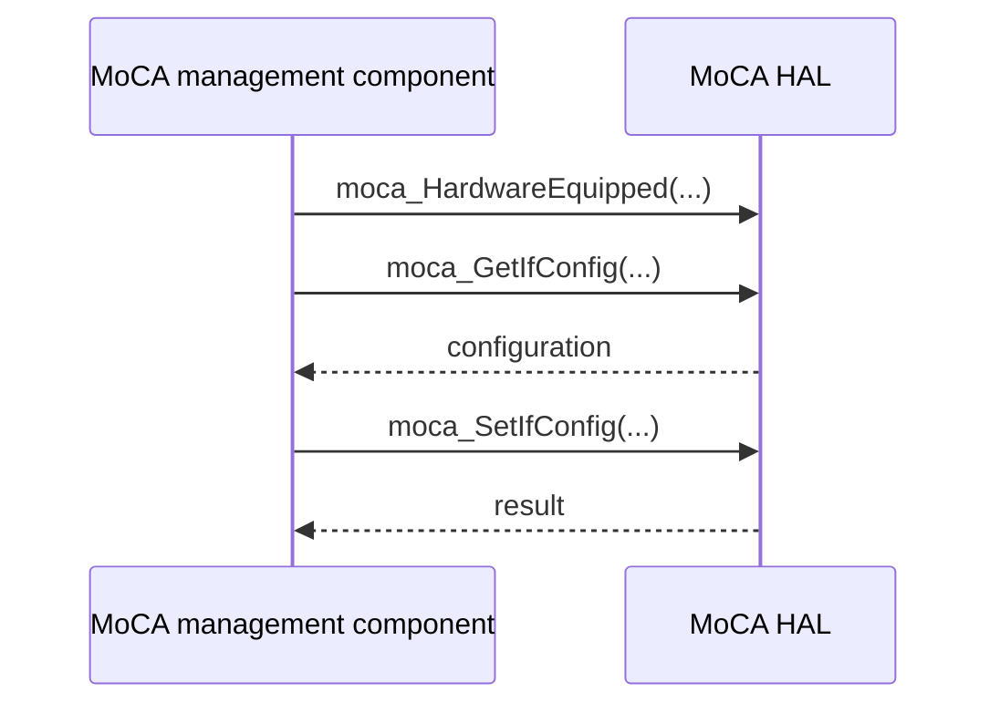

# MoCA HAL Specification

## Version History

| Date | Comment | Version |
| --- | --- | --- |
| — | Documentation alignment; no ABI change. | — |

## Acronyms
HAL means Hardware Abstraction Layer; MoCA means Multimedia over Coax Alliance; CPE means Customer Premises Equipment.

## Description
The MoCA management component uses this HAL for interface configuration, topology, statistics, notifications, and advanced diagnostics.

## Optional Components
MoCA hardware and conditional `MOCA_VAR` declarations depend on the product. Query hardware availability before relying on a usable interface.

## Component Runtime Execution Requirements
### Initialization and Startup
Check hardware availability with `moca_HardwareEquipped` before dependent operations.
### Threading Model
Serialize operations unless the vendor guarantees concurrency.
### Process Model
Use the vendor library in process and coordinate configuration writers.
### Memory Model
Callers own supplied storage unless otherwise stated by an individual declaration. Respect array counts and buffer sizes in the header.
### Power Management Requirements
Interface configuration is not a separate system power-management contract.
### Asynchronous Notification Model
`moca_associatedDevice_callback_register` registers device notifications. Confirm callback thread, lifetime, and unregister behavior before teardown.
### Internal Error Handling
Check each function's return contract and consume output only after success.

## Nonfunctional Requirements
### Logging and Debugging
Implementations must not log credentials, secrets, security-sensitive information, or other sensitive data. Log operation outcomes rather than payloads.
### Quality Control
Use compiler warnings, static analysis, memory checks, and hardware-qualified counter/configuration tests.
### Licensing
See repository Apache-2.0 notices.
### Build Requirements
Compile against the public header and link the product implementation; legacy packaging names `libhal_moca.so`.
### Variability Management
Respect conditional types and operations, particularly `MOCA_VAR`.

## Interface API Documentation
- Configuration: `moca_GetIfConfig`, `moca_SetIfConfig`.
- Interface observations: `moca_IfGetDynamicInfo`, `moca_IfGetStaticInfo`, `moca_IfGetStats`, `moca_GetResetCount`.
- Counters: `moca_IfGetExtCounter`, `moca_IfGetExtAggrCounter`.
- Topology: `moca_GetNumAssociatedDevices`, `moca_GetMocaCPEs`, `moca_GetAssociatedDevices`, `moca_GetFullMeshRates`.
- Notification: `moca_associatedDevice_callback_register`.
- Utilities and availability: `moca_FreqMaskToValue`, `moca_HardwareEquipped`.
- Flow and diagnostics: `moca_GetFlowStatistics`, `moca_setIfAcaConfig`, `moca_getIfAcaConfig`, `moca_cancelIfAca`, `moca_getIfAcaStatus`, `moca_getIfScmod`.

The linked header supplies signatures, field units, capacities, and individual return codes.

### Theory of Operation and Key Concepts
Read current configuration before changing selected fields. Associated-device count and a later list fetch may observe different moments.

### Sequence Diagram

## Source References
- [moca_hal.h](https://github.com/rdkcentral/rdkb-halif-moca/blob/develop/include/moca_hal.h)
